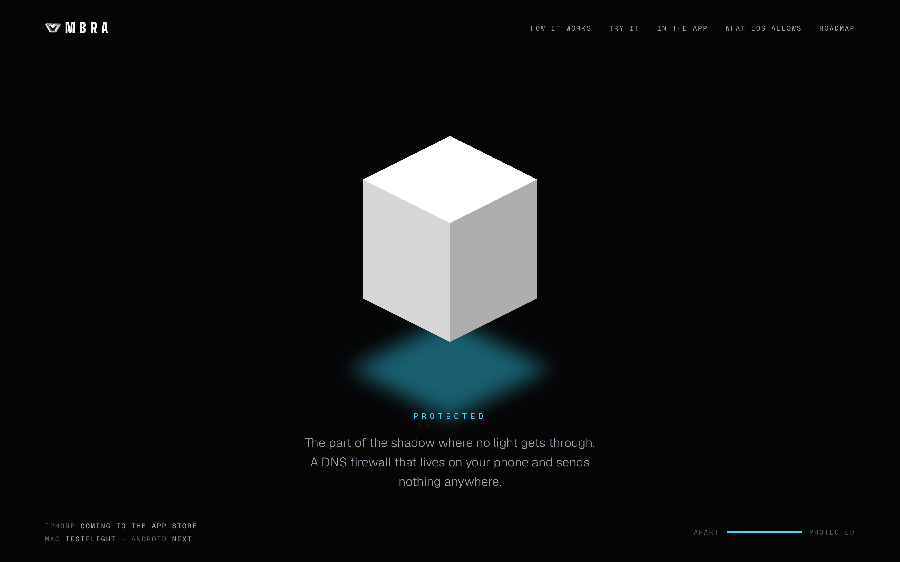
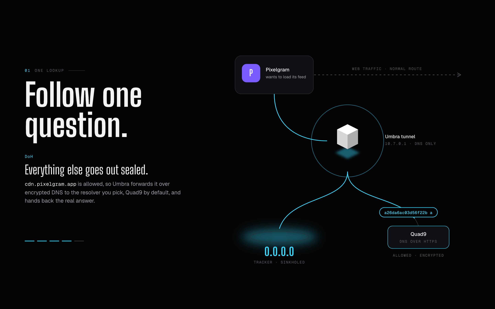
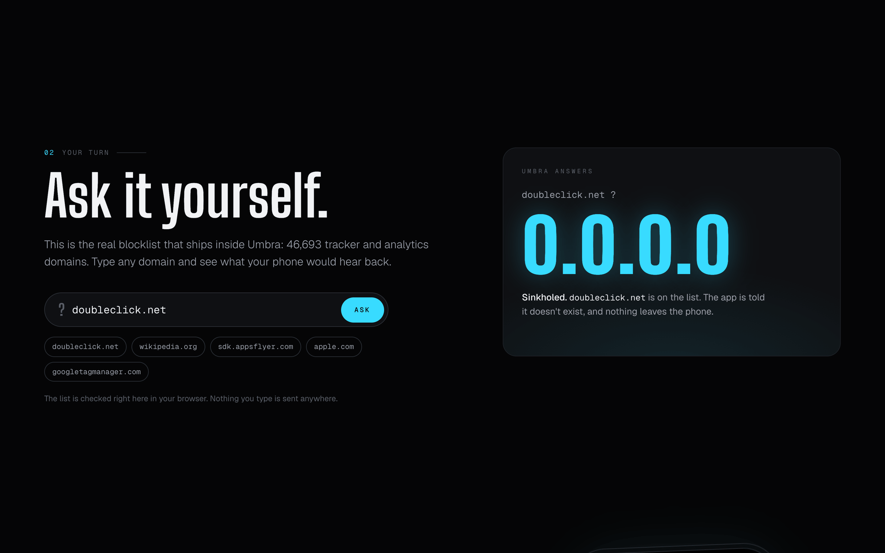
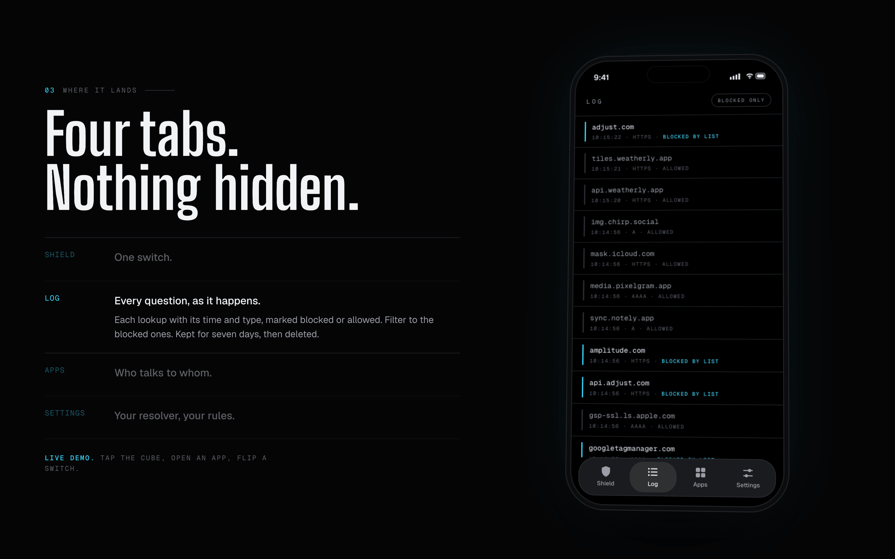
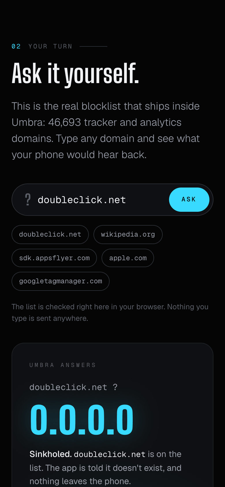
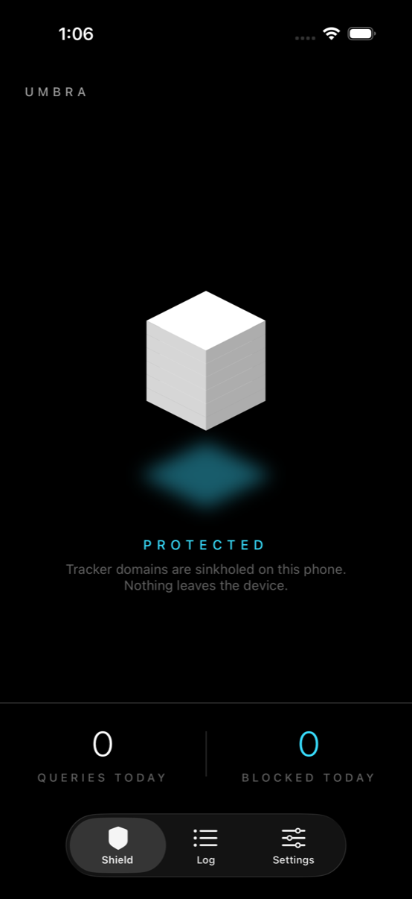
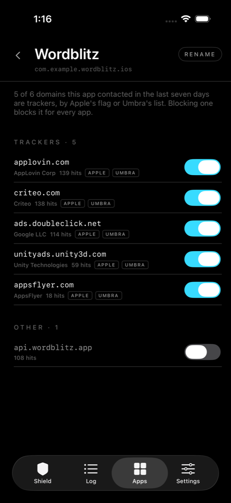
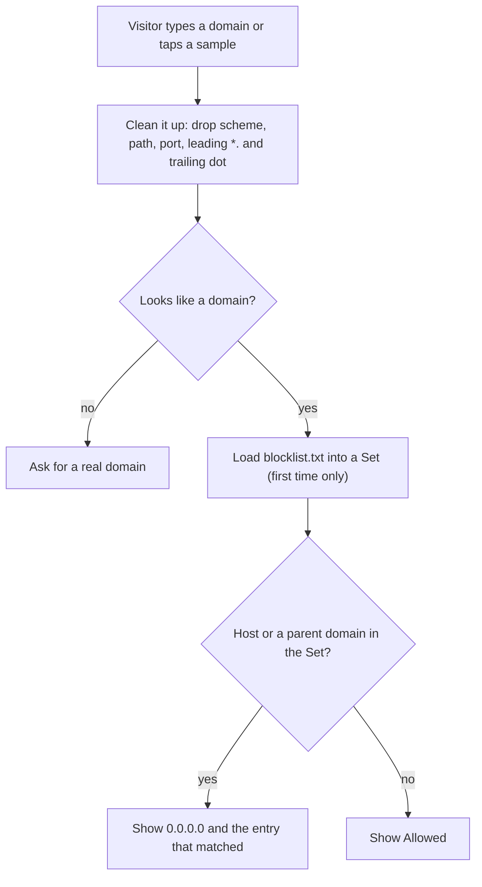

# Umbra site

The website for Umbra, a DNS firewall for iPhone that blocks tracker domains on the phone and shows every domain the phone looks up. It is plain HTML with no build step: one page, a privacy policy and a copy of the app's blocklist.

Live at [umbra-site-ecru.vercel.app](https://umbra-site-ecru.vercel.app).



## What's on the page

| Section | What it does |
| --- | --- |
| Hero | Scrolling assembles six gray slabs into one white cube, and the label changes from Off to Protected. |
| 01 One lookup | A pinned, scroll-driven SVG follows two DNS questions from a made-up app. The tracker gets `0.0.0.0`, the allowed one goes to Quad9 over DNS over HTTPS, and both land in the log. |
| 02 Ask it yourself | Type any domain and see whether Umbra's blocklist would block it. |
| 03 Where it lands | A tappable iPhone with the app's four tabs (Shield, Log, Apps, Settings), running on invented apps and traffic. |
| 04 What iOS allows | Four things iOS doesn't let an app do, and what Umbra does instead. |
| 05 What's next | iPhone, Mac and Android status, and three numbers: 0 servers, 1 route into the tunnel, 7 days of log. |

| One lookup | Ask it yourself |
| --- | --- |
|  |  |



The page at phone width, then two screenshots from the iPhone app:

<p>
  
  
  
</p>

The page screenshots are captures of this repository in headless Chrome at 2x, taken on 2026-11-08.

## How "Ask it yourself" works



The check runs in the browser against `blocklist.txt` (46,693 domains, about 1 MB), so what you type is never sent anywhere. The file is fetched once, when the input first gets focus or on the first question. `sdk.appsflyer.com` is blocked because `appsflyer.com` is listed; parent domains are checked up to, but not including, the top-level domain.

The `POST /dns-query` line under an Allowed answer is random hex for illustration. The page makes no DNS queries.

The only requests to other hosts are for the Google Fonts stylesheet and its font files.

## Run locally

```sh
python3 -m http.server 8000
```

Open `http://localhost:8000`. Use a server rather than opening `index.html` from disk: from `file://` the page renders, but the browser blocks the blocklist fetch and the Ask box reports that the list didn't load. Running the site does not start a DNS tunnel; only the app does that.

## Project structure

```
index.html      The page, with its CSS and JavaScript inline
privacy.html    Privacy policy for the app
blocklist.txt   The domains the Ask box checks
img/            Logo, icon and iPhone app screenshots
docs/           Screenshots for this README
```

The page's source of truth is the `web/` folder of the private Umbra project repository, and this repository is the copy Vercel serves. `blocklist.txt` is a copy of `UmbraCore/Sources/UmbraCore/Resources/blocklist.txt` from that project.

If the list changes, update the count in `index.html`. The figure in the Ask section is replaced with the real count once the list loads, but the one on the demo phone's Settings tab is fixed text.

The blocklist is derived from EasyPrivacy by The EasyList authors and offered under CC BY-SA 3.0, as the header of `blocklist.txt` says.
